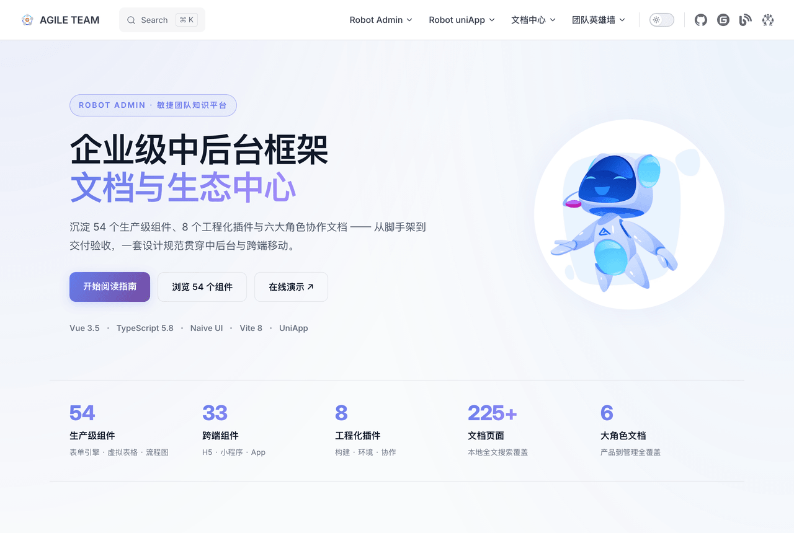

<div align="center">

<a href="https://www.tzagileteam.com">
  
</a>

<br>

# AGILE TEAM

**Robot Admin 企业级中后台框架 · 敏捷团队一站式文档站**

*拥抱开放，拥抱变化*

`Vue 3.5` · `TypeScript 5.8` · `Naive UI 2.44` · `Vite 8` · `VitePress` · `UniApp`

<br>

[![CI][ci-badge]][ci-url]
[![License: MIT][license-badge]][license-url]
[![npm][components-badge]][components-url]
[![npm downloads][components-dt-badge]][components-url]
[![npm][machtable-ver-badge]][machtable-url]
[![npm][machreport-ver-badge]][machreport-url]
[![npm][cli-badge]][cli-url]
[![Docs][docs-badge]][docs-url]

**[📖 文档站][docs-url]** &nbsp;·&nbsp; **[🎯 在线演示][demo-url]** &nbsp;·&nbsp; **[🧩 组件文档][components-doc-url]** &nbsp;·&nbsp; **[⚙️ Mach 双引擎][machtable-doc-url]** &nbsp;·&nbsp; **[📦 生态包][packages-doc-url]** &nbsp;·&nbsp; **[⚡ 脚手架][cli-doc-url]** &nbsp;·&nbsp; **[📋 更新日志](https://www.tzagileteam.com/changelog)** &nbsp;·&nbsp; **[English](./README_EN.md)**

[](https://www.tzagileteam.com)

</div>

---

## 📊 项目一览

| &nbsp; | &nbsp; | &nbsp; | &nbsp; | &nbsp; |
| :---: | :---: | :---: | :---: | :---: |
| **63** | **35** | **2** | **8+8** | **270+** |
| 生产级组件 | 跨端组件 | Mach 自研引擎 | 插件与生态包 | 文档页面 |
| 表单引擎/数据选择/流程图 | H5/小程序/App | 数据表格·报表输出 | 8 工程化插件 · 8 生态包 | 六大角色全覆盖 |

**性能基线** — 热更新 <100ms · 首屏 <2s · 产物 <2MB · 本地全文搜索

## ⚙️ Mach 双引擎

面向复杂 B 端业务的自研引擎矩阵，框架无关内核、前后端共用契约，[平台文档][machtable-doc-url]与组件文档同级深度（接入 / Props / 配置项 / API / 事件 / 场景配方全覆盖）：

| 引擎 | 定位 | 版本 | 能力亮点 |
| :---: | :--- | :---: | :--- |
| 📊 **MachTable** | 企业数据表格引擎（Vue / React 双适配） | `v0.42.1` | 行列双虚拟化 · 编辑事务与乐观锁 · 远程查询工作流 · 12 域 API · 8 个高级子入口 |
| 🖨️ **MachReport** | 分页报表引擎 + Vue 3 预览组件 | `v2.26.1` | 完整宽表/毫米纸张 · Excel 导入绑定 · 规则填报核对 · PDF/XLSX/PNG 输出 · 工业标签 · Node Runtime |

Robot_Admin v2.7.0 已正式消费 MachTable 0.42.1 并通过三浏览器回归验收；两引擎均提供 Naive UI / Element Plus 官方集成指南。

## 🏗 架构总览

```
                    ┌─────────────────────────────────┐
                    │        AGILE TEAM 文档站         │
                    │   VitePress · 深色模式 · 全文搜索   │
                    └────────────────┬────────────────┘
                                     │
        ┌────────────────────────────┼────────────────────────────┐
        │                            │                            │
┌───────▼────────┐          ┌────────▼────────┐          ┌────────▼────────┐
│   Robot_Admin   │          │  Robot_Uniapp    │          │    工具链生态     │
│  中后台主框架 v2.7 │          │  跨端框架 v1.0    │          │                  │
│  Vue3·TS·Vite8  │          │  H5/小程序/App    │          │  · robot-cli 3.3 │
└───────┬────────┘          └────────┬────────┘          │  · 8 个工程化插件  │
        │                            │                   │  · 8 个生态包      │
        └──────────┬─────────────────┘                   └──────────────────┘
                   │
     ┌─────────────▼──────────────┐      ┌─────────────────────┐      ┌──────────────────┐
     │ @robot-admin/naive-ui-     │      │ @agile-team/        │      │ Robot_H5  v1.8    │
     │ components  v0.40.5        │      │ mach-table 0.42.1   │      │ @robot-h5/core    │
     │ 63 组件 · 按需自动导入        │──────│ mach-report 2.26.1  │      │ Robot_Cloud v1.0  │
     └────────────────────────────┘      │ Mach 双引擎          │      └──────────────────┘
                                         └─────────────────────┘
```

## ✨ 核心特性

| | |
| :--- | :--- |
| **🧩 组件工程化** | 63 个业务组件独立包，`RobotNaiveUiResolver` 按需自动导入，TypeScript 类型完备，在线演示 | 
| **⚙️ Mach 双引擎** | `@agile-team/mach-table` 数据表格引擎（Vue/React 双适配）与 `@agile-team/mach-report` 报表引擎（PDF/Excel/工业标签） |
| **📱 跨端同构** | 一套设计规范贯穿中后台与移动端，uniApp 覆盖 H5 / 微信小程序 / Android / iOS，Robot_H5 深耕 WebView/PDA |
| **⚡ 极速起步** | `npx` 一行命令 60 秒创建项目，三步流程、非交互参数、自动检测 bun / pnpm |
| **🔌 插件与生态包** | 8 个工程化插件 + 8 个 `@robot-admin/*` 生态包（请求/字典/校验/文件/指令/布局/主题/Git 标准化） |
| **📖 知识资产化** | 产品 / 设计 / 前端 / 后端 / 测试 / 运维 / 管理六大角色文档与团队英雄墙 |
| **🌗 现代文档体验** | 深色模式、本地全文搜索、组件真实环境嵌入演示、页面级评论区、og 分享卡 |

## 🧩 组件体系

<details open>
<summary><b>表单与输入</b>（16 个）</summary>

`C_Form` 动态表单引擎（8 种布局）· `C_FormSearch` 高级搜索 · `C_FormModal` 弹窗表单 · `C_Select` 选择器 · `C_AutoComplete` 自动完成 · `C_DataPicker` 数据选择器 · `C_UserPicker` 人员选择 · `C_Cascade` 级联选择 · `C_City` 城市选择 · `C_Date` / `C_Time` 日期时间 · `C_Cron` Cron 表达式 · `C_Upload` 增强上传 · `C_Captcha` 拼图验证码 · `C_Transfer` 穿梭框 · `C_Tree` 树形控件

</details>

<details>
<summary><b>表格与数据</b>（10 个）</summary>

`C_Table` 超级表格（虚拟滚动/树形/导出）· `C_VtableGantt` 甘特图 · `C_Draggable` 拖拽排序 · `C_Timeline` 时间线 · `C_Steps` 步骤条 · `C_Progress` 进度 · `C_Skeleton` 骨架屏 · `C_AvatarGroup` 头像组 · `C_OrgChart` 组织架构 · `C_BatchResult` 批量结果

</details>

<details>
<summary><b>可视化与编辑</b>（10 个）</summary>

`C_AntV` X6 图形引擎（BPMN/ER/UML）· `C_WorkFlow` 工作流编辑器 · `C_Editor` 富文本 · `C_Markdown` · `C_Code` 代码编辑器 · `C_FormulaEditor` 公式编辑 · `C_FullCalendar` 日程 · `C_Map` Leaflet 地图 · `C_QRCode` / `C_Barcode` 二维码与条形码

</details>

<details>
<summary><b>媒体与业务</b>（15 个）</summary>

`C_FilePreview` 文件预览（PDF/Office）· `C_VideoPlayer` · `C_AudioPlayer` · `C_ImageCropper` 裁剪 · `C_Signature` 电子签名 · `C_Chat` 聊天 · `C_Login` 登录面板 · `C_ContextMenu` 右键菜单 · `C_GlobalSearch` 全局搜索 · `C_Guide` 新手引导 · `C_Menu` / `C_Breadcrumb` / `C_TagsView` 导航 · `C_NotificationCenter` 通知中心 · `C_ActionBar` 操作按钮组

</details>

<details>
<summary><b>布局与反馈</b>（12 个）</summary>

`C_SplitPane` 分割面板 · `C_CollapsePanel` 折叠面板 · `C_Tabs` 标签页 · `C_WaterFall` 瀑布流 · `C_Theme` 主题 · `C_Language` 国际化 · `C_Icon` · `C_Loading` / `C_PageLoading` 加载 · `C_Density` 区域密度 · `C_ErrorSummary` 错误汇总 · `C_SectionNav` 锚点导航 · 指令：`v-copy` · `v-watermark` · `v-drag` · `v-permission` · `v-debounce` 等 11 个（[@robot-admin/directives][packages-doc-url]）

</details>

所有组件均提供 **[在线演示][demo-url]**（嵌入 robotadmin.cn 真实环境）、TypeScript 类型定义与 [完整 API 文档][components-doc-url]。布局骨架（`C_LayoutContainer` 六种布局 + 设置抽屉）由生态包 [@robot-admin/layout][packages-url] 提供。

## 📦 生态矩阵

| 项目 | 版本 | 定位 | 说明 |
| --- | :---: | --- | --- |
| [Robot_Admin][demo-url] | `v2.7.0` | 中后台主框架 | Vue 3.5 · TS 5.8 · Vite 8 · UnoCSS · Pinia |
| [@robot-admin/naive-ui-components][components-url] | `v0.40.5` | 组件库独立包 | 63 组件 · 自动导入 · 独立发版 |
| [@agile-team/mach-table][machtable-url] | [![npm][machtable-ver-badge]][machtable-url] [![npm][machtable-dt-badge]][machtable-url] | 企业数据表格引擎 | 框架无关 · Vue/React 双适配 · 虚拟化 · 编辑事务 — [平台文档][machtable-doc-url] |
| [@agile-team/mach-report][machreport-url] | [![npm][machreport-ver-badge]][machreport-url] [![npm][machreport-dt-badge]][machreport-url] | 报表引擎 | 宽表/纸张 · Excel 绑定 · PDF/XLSX/PNG · 工业标签 — [平台文档][machreport-doc-url] |
| [robot-admin-packages][packages-url] | 8 个生态包 | 公共能力 Monorepo | request-core · dictionary · form-validate · file-utils · directives · layout · theme · git-standards — [平台文档][packages-doc-url] |
| [@agile-team/robot-cli][cli-url] | `v3.3.0` | 脚手架 | 三步建项 · 非交互参数 · PC Full/Lite + H5 |
| Robot_Uniapp | `v1.7.2` | 跨端移动框架 | 35 组件 · wot-design-uni · H5/小程序/App |
| [Robot_H5][roboth5-url] | `v1.8.0` | 移动 H5 应用框架 | Vue 3 · Vite 7 · Vant · 15 设备 Hook · wl-mbase — [平台文档][roboth5-doc-url] |
| [@robot-h5/core][h5core-url] | `v1.2.0` | H5 核心能力包 | Bridge 通信 · 20+ Hooks · 离线存储 |
| Robot_Cloud | `v1.0.0-SNAPSHOT` | 后端微服务框架 | Spring Cloud Alibaba · 认证 / 系统管理 / 权限治理 |

<details>
<summary><b>🔌 8 个工程化插件</b></summary>

| 插件 | 用途 |
| --- | --- |
| `naive-ui-components` | 组件库独立包 |
| `robot-admin-env-manager` | 多环境配置管理 |
| `vite-plugin-preloader` | 首屏加载优化 |
| `ts-type-cleaner` | TS 类型文件清理 |
| `mgit-push` | 多仓库同步推送 |
| `git-branch-check-diff-commits` | 分支差异检查 |
| `vscode-config` | 团队 VSCode 统一配置 |
| `console` | 开发调试增强 |

</details>

<details>
<summary><b>📦 8 个生态包（robot-admin-packages，独立版本 + Changesets 发版）</b></summary>

| 包 | 版本 | 用途 |
| --- | :---: | --- |
| `@robot-admin/request-core` | 0.7.0 | 实例级 Axios 编排 + Vue Headless CRUD |
| `@robot-admin/dictionary` | 0.6.1 | 字典/枚举弹性加载 + 可选 Vue 集成 |
| `@robot-admin/form-validate` | 3.4.4 | RuleSpec 规则源，Naive UI / Element Plus 双适配 |
| `@robot-admin/file-utils` | 3.0.4 | Excel/CSV/ZIP/图片/下载/可续传分片 |
| `@robot-admin/directives` | 2.0.2 | 11 个 Vue 3 交互指令 |
| `@robot-admin/layout` | 3.3.4 | 6 种布局骨架 + 设置抽屉 |
| `@robot-admin/theme` | 0.6.2 | 设计 Token · 明暗/3 套风格 · Pinia |
| `@robot-admin/git-standards` | 1.0.6 | `robot-standards` CLI，Git 工程标准化 |

</details>

## 🚀 快速开始

**方式一：脚手架创建中后台项目**

```bash
npx @agile-team/robot-cli create my-project
```

**方式二：本地运行文档站**

```bash
git clone https://github.com/ChenyCHENYU/AgileTeam_Doc.git
cd AgileTeam_Doc
bun install        # 安装依赖（推荐 Bun）
bun run dev        # 启动文档站 → http://localhost:5888
bun run build      # 同步 CHANGELOG 并构建生产版本
```

## 📖 文档中心

| 角色 | 内容入口 |
| --- | --- |
| 📋 产品 | [需求调研 · 分析 · 方案 · 规范][po-url] |
| 🎨 设计 | [设计规范 · 视觉风格 · 工作流程][ui-url] |
| 💻 前端 | [编码规范 · 工程架构 · Vue3 实战][web-url] |
| ⚙️ 后端 | [编码规范 · 工程架构 · 快速上手][rearend-url] |
| 🧪 测试 | [测试策略 · 用例设计 · 质量标准][qc-url] |
| 👔 管理 | [岗位职责 · 27+ 模板 · 交付验收][manage-url] |
| 📋 站点 | [更新日志](https://www.tzagileteam.com/changelog)（自动同步 CHANGELOG.md） |

<details>
<summary><b>📁 文档站项目结构</b></summary>

```
docs/
├── .vitepress/            # 配置 + 主题定制
│   ├── _config/           # 模块化配置（nav/sidebar/search/SEO/versions 版本事实源）
│   ├── components/        # Vue 组件（HomePage/DemoIframe/评论区）
│   └── theme/             # 主题（宽屏适配/首页样式）
└── document/
    ├── robot/             # Robot Admin（指南/组件/插件/生态包/CLI）
    ├── mach/              # Mach 生态（MachTable / MachReport 深度文档）
    ├── uniapp/            # Robot uniApp（指南/组件）
    ├── h5/                # Robot_H5 移动框架
    ├── changelog.md       # 更新日志（脚本自动同步）
    ├── po/ ui/ web/       # 产品 · 设计 · 前端
    ├── rear-end/ qc/ op/  # 后端 · 测试 · 运维
    ├── manage/            # 管理（职责/模板/验收）
    └── team/              # 团队英雄墙
```

</details>

## 🛡 工程化质量

- **CI**：GitHub Actions 全量构建校验（bun install → 内容保鲜检查 → 嵌入策略测试 → vitepress build 死链检测）
- **Lighthouse CI**：性能 / SEO / 无障碍预算守护，覆盖首页、指南、Mach 深度页与生态包页
- **SEO**：sitemap + robots.txt + 页面级 og 标签（含 1200×630 分享卡）与 canonical
- **内容保鲜**：版本敏感页面带 `reviewAfter` 复审日期，过期即 CI 失败；生态版本集中于 `_config/versions.js` 事实源
- **CHANGELOG 自动同步**：`bun run build` 前自动生成站内更新日志页
- **og 分享卡**：`bun run og:image` 重绘（读 versions.js）；刻意不挂进 CI 构建——分享卡含中文文字渲染，依赖本机字体，CI Linux 环境会出豆腐块
- **性能**：静态资源 immutable 缓存 · 图片 WebP 化 · 关键动画合成层优化
- **内嵌文档**：`vercel.json` 的 CSP `frame-ancestors` 仅允许文档站自身、`robotadmin.cn` / `www.robotadmin.cn` 及本机 `localhost` / `127.0.0.1`（任意开发端口）嵌入；不使用禁止跨域嵌入的 `X-Frame-Options: SAMEORIGIN`。新增部署域名时须明确加入来源名单并运行 `bun run test`，响应头变更需部署文档站后才生效。

## 🤝 参与共建

欢迎通过 [Issue][issues-url] 反馈问题或提交 Pull Request，文档站每个页面右下角均支持「在 GitHub 上编辑」。

## 📄 License

[MIT](./LICENSE) © 2025 CHENY · 金恒西安

**相关链接**：[博客][blog-url] · [GitHub 主页][github-url] · [更新日志](./CHANGELOG.md) · [参与共建](./CONTRIBUTING.md)

<!-- 链接引用定义 -->

[ci-badge]: https://img.shields.io/github/actions/workflow/status/ChenyCHENYU/AgileTeam_Doc/ci.yml?style=flat-square&label=CI
[ci-url]: https://github.com/ChenyCHENYU/AgileTeam_Doc/actions/workflows/ci.yml
[license-badge]: https://img.shields.io/badge/License-MIT-18A058?style=flat-square
[license-url]: ./LICENSE
[components-badge]: https://img.shields.io/npm/v/@robot-admin/naive-ui-components?style=flat-square&color=18A058&label=naive-ui-components
[components-dt-badge]: https://img.shields.io/npm/dt/@robot-admin/naive-ui-components?style=flat-square&color=18A058&label=downloads
[components-url]: https://www.npmjs.com/package/@robot-admin/naive-ui-components
[cli-badge]: https://img.shields.io/npm/v/@agile-team/robot-cli?style=flat-square&color=18A058&label=robot-cli
[cli-url]: https://www.npmjs.com/package/@agile-team/robot-cli
[docs-badge]: https://img.shields.io/badge/docs-tzagileteam.com-6366f1?style=flat-square
[docs-url]: https://www.tzagileteam.com
[demo-url]: https://www.robotadmin.cn
[components-doc-url]: https://www.tzagileteam.com/robot/components/preface
[cli-doc-url]: https://www.tzagileteam.com/robot/cli/
[guide-url]: https://www.tzagileteam.com/robot/guide/overview
[plugin-url]: https://www.tzagileteam.com/robot/plugin/console
[uniapp-url]: https://www.tzagileteam.com/uniapp/guide/overview
[h5core-url]: https://www.npmjs.com/package/@robot-h5/core
[roboth5-url]: https://github.com/ChenyCHENYU/Robot_H5
[roboth5-doc-url]: https://www.tzagileteam.com/h5/overview
[machtable-url]: https://www.npmjs.com/package/@agile-team/mach-table
[machtable-ver-badge]: https://img.shields.io/npm/v/@agile-team/mach-table?style=flat-square&color=18A058&label=mach-table
[machtable-dt-badge]: https://img.shields.io/npm/dm/@agile-team/mach-table?style=flat-square&color=18A058&label=downloads
[machtable-doc-url]: https://www.tzagileteam.com/mach/preface
[machreport-url]: https://www.npmjs.com/package/@agile-team/mach-report
[machreport-ver-badge]: https://img.shields.io/npm/v/@agile-team/mach-report?style=flat-square&color=18A058&label=mach-report
[machreport-dt-badge]: https://img.shields.io/npm/dm/@agile-team/mach-report?style=flat-square&color=18A058&label=downloads
[machreport-doc-url]: https://www.tzagileteam.com/mach/report
[packages-url]: https://github.com/ChenyCHENYU/robot-admin-packages
[packages-doc-url]: https://www.tzagileteam.com/robot/packages/preface
[po-url]: https://www.tzagileteam.com/po/standard/introduction
[ui-url]: https://www.tzagileteam.com/ui/standard/introduction
[web-url]: https://www.tzagileteam.com/web/get-familiar-quickly/engineering
[rearend-url]: https://www.tzagileteam.com/rear-end/standard/norm
[qc-url]: https://www.tzagileteam.com/qc/standard/norm
[manage-url]: https://www.tzagileteam.com/manage/job-responsibility/pm
[issues-url]: https://github.com/ChenyCHENYU/AgileTeam_Doc/issues
[blog-url]: https://yangchenyu.top
[github-url]: https://github.com/ChenyCHENYU
